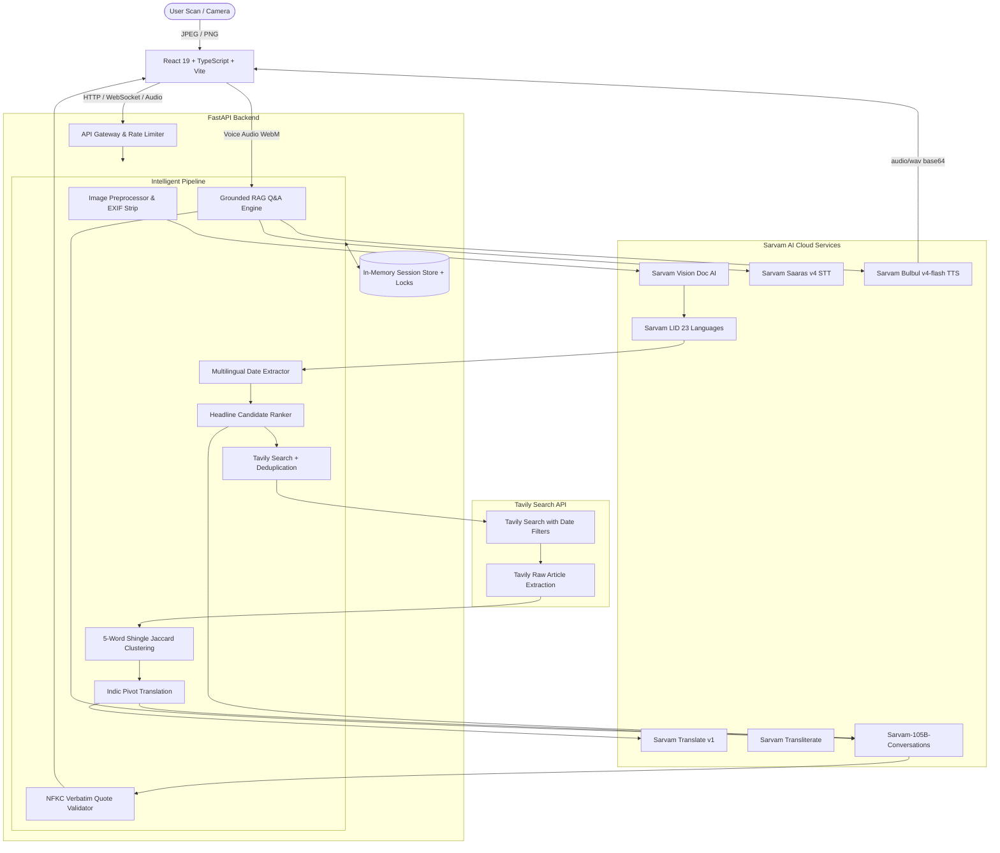

# KhabarLens (खबरलेंस) 🔍📰
### Multilingual Newspaper Intelligence & Evidence-Linked Story Platform

[](https://www.python.org/)
[](https://fastapi.tiangolo.com)
[](https://react.dev)
[](https://www.typescriptlang.org)
[](https://tailwindcss.com)
[](https://www.sarvam.ai)
[](https://tavily.com)

**KhabarLens** bridges physical print journalism and digital web intelligence across **23 Indian languages**. A user snaps a photograph of a physical print newspaper article in any Indian script. KhabarLens digitizes the article, extracts publication datelines, discovers corroborating or conflicting web reporting via Tavily within the relevant time window, clusters syndicated copies, builds an evidence-linked story (chronological timeline + cross-source perspectives with verbatim quotes), and enables spoken or written voice Q&A powered by Sarvam AI.

---

## 1. System Architecture



---

## 2. Key Features

1. **Indian Newspaper Digitisation:**
   - Preprocesses print scans (rotation check, minimum 600px short dimension, EXIF stripping).
   - Sarvam Vision Doc AI digitizes layout, headings, columns, and body paragraphs.
   - Batch Language Identification across 23 scheduled Indian languages.
2. **Dateline & Headline Detection:**
   - Extracts publication dates from print mastheads supporting English, Hindi (textual and Devanagari numerals `०-९`), and ISO date patterns.
   - Generates 3–8 candidate headlines with confidence scores, allowing one-click selection or custom entry.
3. **Syndicated Wire Clustering:**
   - 5-word shingle Jaccard overlap clustering (threshold $\ge 0.60$) detects wire duplicates (e.g. PTI / ANI syndications across multiple portals) to prevent false "conflicts".
4. **Verbatim Quote & Evidence Verification:**
   - Every single timeline claim and perspective position must be backed by a **verbatim quote** ($\ge 20$ characters) matching the source text under Unicode NFKC normalization.
   - Hallucinated quotes and fabricated source IDs are pruned automatically before user presentation.
5. **Conversational Multilingual Q&A with Voice:**
   - Ask questions via text or spoken audio in Indian languages.
   - Voice audio is transcribed via Sarvam Saaras STT (`saaras:v4`).
   - Answers are grounded strictly in S0..Sn sources with clickable citation chips.
   - Audio narration is synthesized via Sarvam Bulbul TTS (`bulbul:v4-flash`) using verified native Indic speakers.

---

## 3. Technology Stack

* **Backend:** Python 3.11+, FastAPI, Uvicorn, httpx, Pydantic v2, Pillow, respx, pytest
* **Frontend:** React 19, TypeScript, Vite, Tailwind CSS v4, Lucide Icons, Vitest, Testing Library
* **AI Models & Vendors:**
  * **LLM:** `sarvam-105b-conversations`
  * **STT (Speech-to-Text):** `saaras:v4` (accepts WebM/Opus and MP4 natively)
  * **TTS (Text-to-Speech):** `bulbul:v4-flash`
  * **Translation:** `sarvam-translate:v1`
  * **Language ID:** `text-lid`
  * **Transliteration:** `sarvam-translit`
  * **Web Retrieval:** Tavily Search & Extract

---

## 4. Getting Started

### Prerequisites
* Python 3.11 or higher
* Node.js 18 or higher & npm
* Valid API keys for **Sarvam AI** and **Tavily**

### 1. Environment Configuration
Create a `.env` file in the root repository directory (or copy from `.env.example`):
```env
SARVAM_API_KEY=your-sarvam-api-key
TAVILY_API_KEY=your-tavily-api-key

LLM_MODEL=sarvam-105b-conversations
STT_MODEL=saaras:v4
TTS_MODEL=bulbul:v4-flash
TRANSLATE_MODEL=sarvam-translate:v1
```

### 2. Backend Setup
```bash
# Create virtual environment
python -m venv .venv

# Activate virtual environment
# On Windows PowerShell:
.\.venv\Scripts\Activate.ps1
# On macOS/Linux:
# source .venv/bin/activate

# Install dependencies
pip install -r backend/requirements.txt
```

### 3. Frontend Setup
```bash
cd frontend
npm install
cd ..
```

---

## 5. Running the Application Locally

Run the backend and frontend development servers in two separate terminal windows:

### Terminal 1: Backend Server
```bash
# From workspace root with virtual environment activated:
cd backend
uvicorn app.main:app --host 127.0.0.1 --port 8000 --reload
```
The FastAPI backend will be accessible at: `http://127.0.0.1:8000`  
Interactive Swagger docs: `http://127.0.0.1:8000/docs`  
Health check: `http://127.0.0.1:8000/api/health`

### Terminal 2: Frontend Server
```bash
cd frontend
npm run dev
```
The web application will be accessible at: `http://localhost:5173`

---

## 6. Running Automated Tests & Smoke Verification

### Run Pytest Suite (52 tests)
```bash
# From backend/ directory
cd backend
python -m pytest -v
cd ..
```

### Run Frontend Vitest Suite (6 tests)
```bash
cd frontend
npm test
cd ..
```

### Run Live Cloud Adapter Smoke Test
Verify connectivity to live Sarvam AI and Tavily APIs:
```bash
python scripts/smoke_test.py --adapters
```

### Run End-to-End Pipeline Smoke Test
Test the full pipeline (OCR $\rightarrow$ Headlines $\rightarrow$ Tavily $\rightarrow$ Sarvam-105B $\rightarrow$ QA $\rightarrow$ Bulbul TTS) against a real newspaper scan:
```bash
# Test with English clipping:
python scripts/smoke_test.py --image tests/fixtures/sample_english_clip.jpg

# Test with Hindi clipping:
python scripts/smoke_test.py --image tests/fixtures/sample_hindi_clip.jpg
```

---

## 7. Indic Typography & Font Recommendations

For optimal rendering of Indic scripts (Devanagari, Bengali, Tamil, Telugu, Gujarati, Gurmukhi, Kannada, Malayalam, Odia):
* **Recommended System Fonts:** `Noto Sans Devanagari`, `Mangal`, `Nirmala UI`, `Aparajita`
* **Google Fonts:** The frontend includes Google Fonts `Inter` and `Noto Sans Devanagari` in `index.html` for uniform rendering across Windows, macOS, Android, and iOS.

---

## 8. Hackathon 5-Step Demo Script

Follow this script for a 3-minute hackathon demonstration:

1. **Step 1: Upload a Newspaper Clip**
   - On the KhabarLens home screen (`http://localhost:5173`), upload `tests/fixtures/sample_hindi_clip.jpg` or `tests/fixtures/sample_english_clip.jpg`.
   - Observe the pre-validation and immediate feedback as the image is processed.
2. **Step 2: Select Headline & Verify Date**
   - Notice the detected newspaper masthead publication date (`15 March 2026`).
   - Pick the high-confidence detected headline: *"India Achieves 500 GW Renewable Energy Target Ahead of Schedule"*.
   - Click **Generate Intelligence Story**.
3. **Step 3: Watch Real-Time Stage Progression**
   - The interactive status steps animate through:
     `Searching Web (Tavily)` $\rightarrow$ `Extracting Articles` $\rightarrow$ `Pivot Translation` $\rightarrow$ `Sarvam-105B Story Synthesis` $\rightarrow$ `Verifying Evidence`.
4. **Step 4: Explore Timeline, Perspectives & Evidence Drawer**
   - Browse the chronological timeline with exact and approximate date badges.
   - Observe the **Cross-Source Perspectives** tab showing points of consensus and different publisher emphasis.
   - Click on any **`[S0]` (Newspaper)** or **`[S1]` (Web)** citation chip to open the slide-out **Source Drawer**, revealing the full publisher text with the exact verbatim quote highlighted.
5. **Step 5: Multilingual Voice Q&A**
   - Click the microphone icon in the **Ask Bar** and speak a question (or type: *"What are the key clean energy targets?"*).
   - Watch the transcript appear, followed by a grounded, evidence-backed answer with source citations.
   - Listen to the spoken voice narration automatically synthesized via **Sarvam Bulbul TTS** in the chosen language.

---

## 9. Verification & Audit Trail

Detailed test logs and audit details are documented in [docs/TEST_REPORT.md](docs/TEST_REPORT.md).  
Live API specifications and schemas are documented in [docs/API_NOTES.md](docs/API_NOTES.md).

---

## 10. License

Developed for the Antigravity Indian Multilingual Newspaper Intelligence Challenge. Released under the Apache 2.0 License.
